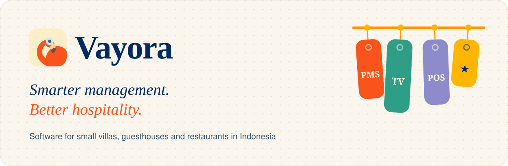

<a href="https://vayora.id">
  <picture>
    <source media="(prefers-color-scheme: dark)" srcset="./assets/banner-dark.svg">
    
  </picture>
</a>

  
  
  

  <b>Vayora</b> builds software for small hospitality businesses in Indonesia: 
  villa owners, guesthouses, <i>kost eksklusif</i>, restaurants and coffee shops 
  who today run everything on spreadsheets, paper calendars and a lot of WhatsApp.

🇮🇩 Perangkat lunak untuk villa, guesthouse dan restoran kecil di Indonesia — satu sistem, bukan spreadsheet dan WhatsApp.

 

## The key board

Every Vayora product hangs from the same hook: one account, one set of numbers, one place to look.

<table>
  <tr>
    <td width="50%" valign="top">
      <h3> Vayora PMS</h3>
      
Property management for 1–10 villas. A villa sells whole <i>or</i> room by room without double booking. Calendar, reservations, payments on one bill, housekeeping with photo proof, linen tracking, and a daily owner report.

      
<a href="https://vayora.id"><b>vayora.id →</b></a>

    </td>
    <td width="50%" valign="top">
      <h3> Booking website</h3>
      
A direct-booking site for each property, reading prices and free dates live from the PMS, so it can never sell a night the front desk already sold. Guests pay now or request a booking; the owner edits it from PMS settings.

    </td>
  </tr>
  <tr>
    <td width="50%" valign="top">
      <h3> Vayora TV</h3>
      
The in-room TV. Guests see a welcome with their name, room, check-out time and Wi-Fi, their streaming apps, and messages from the front desk. Built to run on old smart TVs.

    </td>
    <td width="50%" valign="top">
      <h3> Vayora POS</h3>
      
A cashier for restaurants, kedai and coffee shops. Pay first or pay after eating, QR table ordering, and kitchen tickets — for one outlet or many.

      
<a href="https://pos.vayora.id"><b>pos.vayora.id →</b></a>

    </td>
  </tr>
</table>

## Built for how small properties actually run

- **WhatsApp-native.** Owners approve rooms and act on alerts with one tap from a WhatsApp link.
- **Proof, not promises.** A room is only ready after the caretaker's photos are approved.
- **Indonesian payments.** QRIS, e-wallets, virtual accounts, cards, transfer and cash on one bill.
- **Bahasa Indonesia first**, English one tap away.
- **Phone-first.** Owners are rarely on site; everything works from a phone.

 

   
  <b>Vayora</b> · Smarter management. Better hospitality. 
  Pilot running in Yogyakarta · <a href="https://vayora.id">vayora.id</a>

